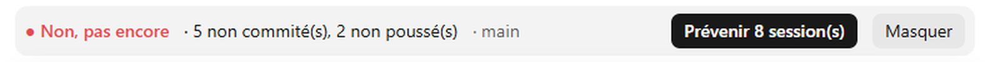

# cloture-indicateur

[](LICENSE) [](https://github.com/michaelmarouen/cloture-indicateur) 

A Claude Code mod that tells you, live and per session, whether you can safely close it.
Un mod Claude Code qui indique en direct, pour chaque session, si tu peux la fermer sans rien perdre.



Au-dessus du prompt, un bandeau affiche l'etat git du depot de la session :

- `Oui, tu peux fermer` : depot propre et pousse.
- `Non, pas encore : N non commite(s), N non pousse(s), sans remote/amont, N stash` : il reste du travail a sauver.
- `Oui, cote git` : le dossier n'est pas un depot git (rien a pousser, verifie tes fichiers toi-meme).

Le calcul se refait au demarrage de la session, puis toutes les 30 secondes tant que le verdict n'est pas vert (un commit ou un push fait dans un terminal est vu sans attendre la fin d'un tour), et toutes les 2 minutes une fois vert ou hors depot ; un outil qui peut modifier le depot (Bash, Edit, Write, outils MCP) force aussi un recalcul. Il tourne en minuteur : il ne retarde pas la fin du tour. Le bandeau est vert (OK), rouge (Non, pas encore) ou jaune (hors depot). Une ligne de statut reprend le verdict, et un toast
apparait quand le depot redevient propre. Le verdict est **par depot** : une autre session qui travaille dans le meme depot
peut avoir des changements non commites qui s'affichent aussi chez toi.

## Installation

Dans un terminal Claude Code :

```
/plugin install cloture-indicateur --marketplace michaelmarouen/cloture-indicateur
```

Ou depuis un shell :

```
claude plugin install cloture-indicateur --marketplace michaelmarouen/cloture-indicateur
```

Dans l'application de bureau, `/plugin` n'existe pas : clique sur +, puis Plugins, Add marketplace avec
`michaelmarouen/cloture-indicateur`, puis Add plugin. Recharge ensuite avec `/reload-plugins` ou ouvre une nouvelle session.

## Bouton « Demander commit+push a la base » (sessions de reprise)

Dans une session de reprise, quand le depot a des fichiers non commites ou non pousses, un bouton envoie un message clair
a la session de base : nom de la reprise, depot, branche, nombre de fichiers, et la demande de commit puis push.

Le mod ne peut pas deviner quelle est la session de base : la session qui lance la reprise doit l'ecrire dans le **premier message** :

```
CLOTURE-BASE: local_<id de la session de base> | <titre de la session de base> | <titre de la reprise>
```

Les deux titres sont facultatifs. Sans ce marqueur, le bouton n'apparait pas. Le mod essaie d'abord `{ sessionId }`, puis l'id comme adresse.

## Bouton « Prévenir les autres sessions du dépôt »

Chaque session ecrit une petite fiche (identifiant, depot, libelle, heure) dans `~/.claude/cloture-registry/`. Quand le depot a des
changements a sauver et que d'autres sessions **vivantes** (fiche reecrite chaque minute, ignoree apres 3 minutes ; une session qui se ferme marque sa fiche comme fermee) travaillent sur le meme depot, le bandeau les liste
et propose un bouton qui leur envoie un message clair : depot, branche, nombre de fichiers, demande de commit puis push
(ou d'ignorer le message si ces changements ne sont pas les leurs). Ne marche que si le mod est actif dans ces autres sessions.
Apres un envoi (aux autres sessions ou a la session de base), le bandeau passe en suivi rapide : il revérifie le depot toutes les 5 secondes (10 minutes au plus), affiche « j'attends que les autres sessions commitent et poussent », puis passe au vert avec un toast des que tout est commite et pousse.
Le resultat de l'envoi reste affiche sur le bandeau (« ✓ 1/1 session(s) prevenue(s) » ou « ✗ 0/1 ... » avec la raison), et un envoi refuse ou en erreur n'est jamais silencieux. **Livre ne veut pas dire lu.** Selon le moteur de Claude Code (textes lus dans son binaire), un message entre deux sessions dont les **modes de permission different** est *retenu* chez le destinataire ; une session Desktop ou non interactive ne peut pas l'approuver, et il expire sans etre lu. Le mod enregistre le mode de chaque session, avertit « ⚠ N session(s) en mode different » et affiche les avis du moteur (retenu, approuve, refuse, expire, abandonne). Un message identique est ecarte par le moteur : chaque envoi porte donc l'heure, et un delai de 15 s separe deux envois. La session qui recoit n'agit que si son propre utilisateur le demande : un message reste une information, pas un ordre. Les fiches ne sont pas effacees, juste ignorees quand elles sont perimees.

## Panneau Clôture (variante 3)

Le bouton **▤ Détail** du bandeau (ou la commande `/cloture`) ouvre un panneau qui répond à la vraie question : peut-on fermer **toutes** les sessions ?

- **Réponse unique** : `Non, pas encore` ou `Oui, tu peux fermer`, avec une jauge de dépôts prêts (`███░░░░░░░ 2/6`), trois vérifications (fichiers à sauver, commits à pousser, jobs lourds) et la prochaine action.
- **Détail par dépôt en 3 affichages**, choisis par de petits boutons à icône : `▾` Dépliant (fichiers listés, par défaut sur ordinateur), `≡` Liste et `▦` Cartes (par défaut sur mobile, plus lisible sur petit écran). Le choix reste possible sur toutes les surfaces. Tous les boutons tiennent sur une seule ligne, sans libellé : le nom de chaque bouton s'affiche au survol, sur la ligne juste dessous.
- Le détail ne liste que les dépôts qui demandent une action (à sauver, à pousser ou sans distant) ; les dépôts propres et poussés ne sont comptés que dans la jauge. Si tout est propre, il le dit en une ligne.
- **Thème** : le bouton `◐` / `☀` / `☾` passe de auto (couleurs du terminal) à clair puis sombre (couleurs fixes, contrastées sur fond clair ou sombre). Le bandeau suit le même thème.
- **Commiter les fichiers régénérés** : bouton en deux appuis (le premier arme, le second confirme) ; il commite par pathspec, dans chaque dépôt concerné, uniquement les fichiers régénérés connus du moteur, jamais le reste.
- La lecture se fait à la demande (environ 7 s pour six dépôts) avec `~/.claude/scripts/cloture_check.py --sessions ... --json` et les sessions vivantes du registre ; jamais sur la minuterie du bandeau. Sans le moteur, le panneau le dit au lieu d'inventer.

## Source unique (optionnel)

Si le fichier `~/.claude/scripts/cloture_check.py` existe et accepte `--git-only <dossier>` (il renvoie un JSON `kind`, `dirty`, `ahead`, `stash`, `branch`, `worktrees`), le mod l'utilise comme source de verite et compte aussi les worktrees. Sinon, ou s'il echoue, une logique git integree prend le relais (sans worktrees).

## Fichiers régénérés et changements antérieurs à la session

Avec `~/.claude/scripts/cloture_check.py`, deux familles de changements n'empêchent plus de fermer :

- **Régénérés** : fichiers déclarés dans `~/.claude/cloture_rules.json` avec leur producteur (ex. `angela_status.html`). Affichés `(+ N régénéré(s), non bloquant)`.
- **Hors session** : déjà présents et inchangés quand la session a démarré. Le mod prend une baseline au `session.start` (`~/.claude/cloture-baseline/<id>.json`, conservée au rechargement) et la passe à `--git-only --baseline`. Affichés `N hors session`.

Un fichier indexé, ou modifié depuis la baseline, reste bloquant. Sans le script, le calcul interne compte tout comme avant.

## Limites

- Il ne lit que git (`status`, `rev-list`, `stash list`). Il ne detecte pas un job en cours (build, entrainement...).
- Il ne peut pas ajouter de bouton dans la liste des sessions : l'API des mods ne le permet pas.
- L'API des mods de Claude Code est en acces anticipe et peut changer entre deux versions.

## Developpement

```
claude plugin validate .
claude plugin test .
node --test test/e2e-git.test.mjs
```

Le second test cree de vrais depots git temporaires (propre, non commite, non pousse, sans remote, stash) et verifie que le mod (et `cloture_check.py` s'il existe) donnent le meme verdict. Il demande Node 22.6 ou plus recent.

Les contributions sont les bienvenues (licence MIT).

## Auteur et licence

Michael-Marouen Confortini, licence MIT (voir `LICENSE`). Issues et suggestions : https://github.com/michaelmarouen/cloture-indicateur/issues
